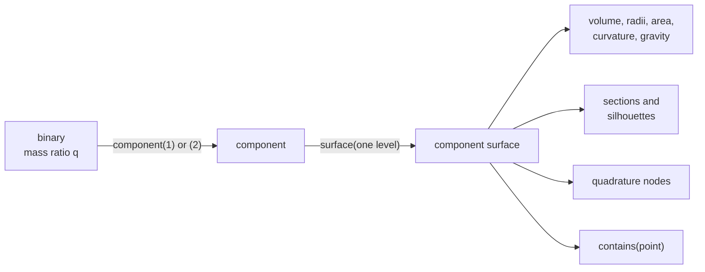

# The Roche model

In the classical Roche model of a binary system, each component's gravity is that of a point mass at its centre, the orbit is circular, and each component rotates synchronously with it ([Kopal 1959](https://scixplorer.org/abs/1959cbs..book.....K), [full text](https://archive.org/details/closebinarysyste00kopa/page/125/mode/1up)).
In the co-rotating frame, gravity and the centrifugal force derive from one potential, the [**Roche potential**](#the-roche-potential).
A component in hydrostatic equilibrium has its surface on an **equipotential**: a surface on which the potential takes one value, its **level**.
In units of the separation, the geometry depends only on the mass ratio `q`, so the surfaces form a family set by `q` and the level.

## Mass ratios

The binary mass ratio is

$$
q = \frac{M_1}{M_2}
$$

with no assumption about which component is more massive: `q` can be greater or less than 1.

In units of the separation `a`, the potential, and so every surface, depends only on `q`.
A binary's physical separation only scales its lengths.
Each component also has its own ratio, its mass over its companion's,

$$
q_i = \frac{M_i}{M_{\mathrm{companion}}},
\qquad
q_1 = q,
\qquad
q_2 = \frac{1}{q},
$$

and in its own frame a component's geometry depends only on `qi`.

Some tools define the mass ratio the other way round, as `M2/M1`; pass its reciprocal to Rocheometry.
[Potentials and critical points](potentials.md#from-wilsondevinney-or-phoebe) shows how to take over their potentials.

## The Roche potential

With component 1 at the origin and component 2 at `(1, 0, 0)`, lengths in units of the separation, and masses as fractions of the total,

$$
U =
\frac{m_1}{r_1}
+
\frac{m_2}{r_2}
+
\frac12\left[(x-m_2)^2+y^2\right],
\qquad
m_1=\frac{q}{1+q},
\quad
m_2=\frac{1}{1+q},
$$

where $r_1^2 = x^2+y^2+z^2$ and $r_2^2 = (x-1)^2+y^2+z^2$.
The first two terms are the components' gravity and the third is the centrifugal term about the centre of mass, at `x = m2`.
`q` is the only parameter.

`U` is positive and rises towards the components, so a level closer to a component has a higher `U`.
The physical effective potential, $-U$ in these units, falls into a well around each component instead; [a recipe](../recipes/potential-well.md) plots it along the line of centres.
[Potentials and critical points](potentials.md) relates it to the physical effective potential and to the Kopal potential.

## Levels and critical points

As the level falls, the equipotentials change shape at the potential's [critical points](potentials.md#critical-points), its Lagrange points:

- At a **detached** level, above L1, each component has its own closed equipotential around it, near-spherical at high levels and drawn out towards the companion as the level falls.
- At the **critical** level, L1, the two meet at L1.
  The region inside each component's equipotential is its **Roche lobe**.
- At a **contact** level, between L1 and L2, the components share one closed equipotential, the **common envelope** around both.
- At or below L2, the level is **open**: the envelope has opened at L2, so its level sets no longer bound a region around the components.

L3, beyond the more massive component, lies at or below L2, so it never bounds a supported surface.

A level set can also have branches away from the components, such as an outer surface around both.
Rocheometry never selects them.

## Dividing a contact envelope

In contact, the **watershed** through L1, a surface made of gravity's field lines, which no gravity crosses, divides the common envelope into two **parts**, one per component ([Fabry, Marchant & Sana 2022](https://doi.org/10.1051/0004-6361/202243094)).
Each part is bounded by its **envelope share**, where `U` equals the level, and by its **cut** on the watershed.
The two meet at the **rim**.
The cut is not equipotential.

## Component surfaces

Rocheometry's central object is the **component surface**, which represents one component's region and its boundary at one level.
At a level `u`, the component's region is the connected part of the superlevel set `U > u` that contains the component, divided at the watershed in contact:

- at a detached level, the region inside the component's own equipotential;
- at the critical level, its Roche lobe;
- at a contact level, its part of the common envelope.

For a detached component or Roche lobe, the whole boundary is equipotential.
For a contact part, it is the envelope share and the cut.
Volume and containment use the whole region; area, curvature, gravity and quadrature use only the envelope share.

Two choices fix a component surface: **which component**, and **which level**.
Everything else follows from them:

- **Every measurement belongs to a surface.** Volumes, radii, areas, curvatures, gravities, outlines, quadrature nodes and inside tests are all read from a component surface.
  The binary and its components hold only what does not depend on a level: critical points, the potential at a point, and the Roche-lobe radius.
- **The Roche lobe is a component surface too**, the one at the L1 level, so `lobe()` gives a surface like any other.
- **Two components at one level are two surfaces.** In a contact binary, select each component at the same level.
- **Views and accuracy settings don't change the surface.** A surface reads the same in its component's own frame or in a binary's frame and units, and `Fitted()` and `Reference()` compute the same surface to different accuracies.

## Sizes and fills

The **volume radius** (volume-equivalent radius) is the radius of a sphere with the surface's volume `V`,

$$
R_{\mathrm{vol}} = \left( \frac{3V}{4 \pi} \right)^{1/3}.
$$

The Roche lobe's is the **Roche-lobe volume radius**.
The **volume-radius fill** compares the two,

$$
\mathrm{fill} = \frac{R_{\mathrm{vol}}}{R_{\mathrm{RL,vol}}},
$$

below one for a detached surface, one for the Roche lobe, and above one for a contact part, up to a maximum at L2.

The **fill-out factor** ([Mochnacki & Doughty 1972](https://doi.org/10.1093/mnras/156.1.51)) is a level's depth below L1, normalized by the depth of L2,

$$
F = \frac{U_{\mathrm{L1}} - U}{U_{\mathrm{L1}} - U_{\mathrm{L2}}},
$$

negative for detached surfaces, zero at L1, between zero and one in contact, and one at L2.
It does not depend on the potential convention, and it is the same for both components at one level.

## Scope

Rocheometry covers component mass ratios `1e-8 <= qi <= 1e8` at levels above L2, the detached, critical and contact levels, within the accuracy it states.
It accepts other mass ratios without a warning, so that sweeps can pass the edges, but their accuracy is not verified.
It gives each component its own region only.

Not supported:

- levels at or below L2, and contours, which include every branch of a level;
- eccentric or asynchronous orbits, and radiation pressure;
- silhouettes at phases other than quadrature, and silhouettes that include a contact part's watershed cut.

## Selecting a surface

A level can be named four ways: by its potential, its fill-out factor, its volume-radius fill or its volume radius.
All four give the same kind of surface, and each surface reports all four back.
[Selecting a surface](surfaces.md#selecting-a-surface) gives the calls.

## Frames

Lengths are in units of the separation `a`, or in physical units when a binary is given a `separation`.
All frames co-rotate with the orbit and are right-handed.

- **Binary frame:** component 1 at the origin and component 2 at `(1, 0, 0)`.
  The `x` axis is the **binary centreline**, traditionally called the line of centres; `y` lies in the orbital plane and `z` along the orbital angular momentum.
- **Centre-of-mass frame:** the binary frame shifted so the barycentre, at `x = 1/(1+q)`, is the origin.
- **Component-local frame:** the selected component at the origin and its companion at `(1, 0, 0)`.
  For component 1 this is the binary frame.
  For component 2,

  $$
  (x, y, z)_{\mathrm{binary}} = (1-x,\ -y,\ z)_{\mathrm{component\ 2}},
  $$

  a translation and a rotation by π about `z`.

The **named directions** of a component are local: point is `+x`, towards the companion; back is `-x`; side is `+y`; pole is `+z`.

## Sections, silhouettes and contours

- A **centreline plane** is any plane containing the binary centreline.
  The orbital plane is one.
- A **section** is the outline of a component surface's region in a plane, either a centreline plane or a plane normal to an axis.
  It can have several closed curves.
  A contact part's section includes its cut.
- A **silhouette** is the projected limb of a component surface.
  It generally differs from a section, though the two can coincide at a symmetric orientation.
  Rocheometry gives silhouettes at **quadrature**, the orbital phase at which the centreline lies in the sky plane; this is unrelated to the surface quadrature that integrates over a surface.
- A **contour** is a level curve of `U` in a plane, including every branch, whichever component it belongs to.
  No Rocheometry API produces contours.
