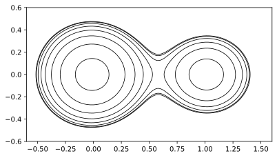

# Draw a surface contour map

Draw height contours of a contact envelope seen from above, with its neck showing as a saddle.
Take sections in z-normal planes at equally spaced heights for both components:

```pycon
>>> from math import ceil
>>>
>>> import matplotlib.pyplot as plt
>>> import rocheometry
>>> from rocheometry import AxisNormalPlane
>>> from rocheometry.matplotlib import path_patch
>>>
>>> binary = rocheometry.BinaryGeometry(q=2.0)
>>> step = 0.06  # height between contours, in units of the separation
>>> fig, ax = plt.subplots()
>>> counts = []
>>> for component in (binary.component(1), binary.component(2)):
...     surface = component.surface(fill_out_factor=0.5)
...     heights = [step * k for k in range(ceil(surface.named_radius("pole") / step))]
...     for height in heights:
...         outline = surface.section_envelope(AxisNormalPlane("z", height))
...         _ = ax.add_patch(path_patch(outline, linewidth=0.8))
...     counts.append(len(heights))
>>> _ = ax.set(xlim=(-0.6, 1.6), ylim=(-0.6, 0.6), aspect="equal")
>>> plt.close(fig)
>>> counts
[8, 6]

```



Each component's heights stop below its pole, where a plane would miss the surface and `section_envelope()` would raise `EmptySectionError`.
`section_envelope()` leaves out the watershed cut, so the two components' arcs join across the neck; for detached surfaces, `section()` gives the same closed loops.
Side-on maps work the same way with y-normal planes.
