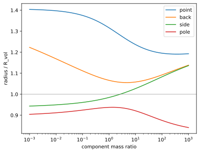

# Compare Roche lobe radii

Compare Roche lobe radii across mass ratios with [Eggleton's formula](https://doi.org/10.1086/160960) and an ellipsoid approximation.
Use the component mass ratio `qi`, the same convention as Eggleton, and the named radii `point`, `back`, `side` and `pole`:

```pycon
>>> from math import log
>>>
>>> import rocheometry
>>>
>>> def eggleton(q):
...     return 0.49 * q ** (2 / 3) / (0.6 * q ** (2 / 3) + log(1 + q ** (1 / 3)))
>>>
>>> print("     q   R_vol  Eggleton  point  back   side   pole   ellipsoid")
     q   R_vol  Eggleton  point  back   side   pole   ellipsoid
>>>
>>> for q in (0.001, 0.01, 0.1, 1.0, 10.0, 100.0, 1000.0):
...     lobe = rocheometry.ComponentGeometry(q).lobe()
...     r = lobe.volume_radius()
...     point, back, side, pole = (
...         lobe.named_radius(name) for name in ("point", "back", "side", "pole")
...     )
...     error = 100 * (eggleton(q) / r - 1)
...     ellipsoid = (point + back) / 2 * side * pole / r**3
...     print(
...         f"{q:6g}  {r:.4f}  {error:+.2f}%"
...         f"   {point / r:.3f}  {back / r:.3f}  {side / r:.3f}  {pole / r:.3f}"
...         f"  {ellipsoid:.3f}"
...     )
 0.001  0.0482  +0.31%   1.404  1.223  0.944  0.904  1.121
  0.01  0.1012  +0.76%   1.397  1.169  0.949  0.912  1.111
   0.1  0.2054  +0.67%   1.375  1.112  0.961  0.924  1.105
     1  0.3799  -0.25%   1.316  1.066  0.985  0.938  1.100
    10  0.5803  -0.37%   1.236  1.058  1.027  0.921  1.085
   100  0.7182  +0.29%   1.195  1.092  1.083  0.875  1.084
  1000  0.7817  +0.46%   1.193  1.139  1.136  0.841  1.114

```

To plot the shape against mass ratio:

```pycon
>>> import matplotlib.pyplot as plt
>>>
>>> qs = [10 ** (k / 10) for k in range(-30, 31)]
>>> names = ("point", "back", "side", "pole")
>>> ratios = {name: [] for name in names}
>>>
>>> for q in qs:
...     lobe = rocheometry.ComponentGeometry(q).lobe()
...     r = lobe.volume_radius()
...     for name in names:
...         ratios[name].append(lobe.named_radius(name) / r)
>>>
>>> fig, ax = plt.subplots()
>>>
>>> for name in names:
...     _ = ax.plot(qs, ratios[name], label=name)
>>> _ = ax.axhline(1.0, color="0.6", linewidth=0.8)
>>> _ = ax.set(xscale="log", xlabel="component mass ratio", ylabel="radius / R_vol")
>>> _ = ax.legend()
>>> plt.close(fig)

```



`R_vol` is in units of the separation, and the four radii are divided by it.
Eggleton's formula stays within 1% of the volume radius across the tabulated mass ratios.
The radius towards the companion is 20–40% longer than the volume radius, and the polar radius 6–16% shorter.

The last column is the ellipsoid's volume divided by the lobe's, using semi-axes `(point + back)/2`, `side` and `pole`.
It is 8–12% too large in these cases: the lobe tapers to a point at L1, and `point` exceeds `back` by up to a quarter.
Ellipsoidal models, such as the biaxial spheroids of EBOP-family light-curve codes, are best kept to components well inside their lobes.
