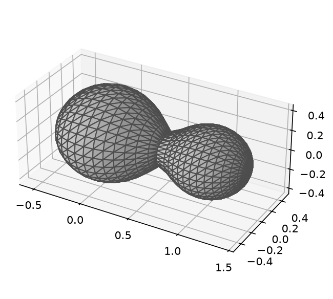

# Export a 3D mesh

Build triangle meshes of both components of a contact binary and prepare a Wavefront OBJ export for Blender, MeshLab or ParaView.
Sample `radius(direction)` on a polar grid about the line of centres, so each component's mesh closes at its front and back:

```pycon
>>> from math import cos, pi, sin
>>>
>>> import rocheometry
>>>
>>> def directions(n_theta, n_phi):
...     """Unit directions on a polar grid about x, with the poles first and last."""
...     yield (1.0, 0.0, 0.0)
...     for i in range(1, n_theta):
...         theta = pi * i / n_theta
...         for j in range(n_phi):
...             phi = 2 * pi * j / n_phi
...             yield (cos(theta), sin(theta) * cos(phi), sin(theta) * sin(phi))
...     yield (-1.0, 0.0, 0.0)
>>>
>>> def triangles(first, n_theta, n_phi):
...     """Triangles over that grid, numbering its vertices from first."""
...     top, bottom = first, first + 1 + (n_theta - 1) * n_phi
...     rings = [
...         [first + 1 + i * n_phi + j for j in range(n_phi)] for i in range(n_theta - 1)
...     ]
...     for j in range(n_phi):
...         k = (j + 1) % n_phi
...         yield (top, rings[0][j], rings[0][k])
...         for upper, lower in zip(rings, rings[1:]):
...             yield (upper[j], lower[j], lower[k])
...             yield (upper[j], lower[k], upper[k])
...         yield (bottom, rings[-1][k], rings[-1][j])
>>>
>>> binary = rocheometry.BinaryGeometry(q=2.0)
>>>
>>> vertices, faces = [], []
>>>
>>> for component in (binary.component(1), binary.component(2)):
...     surface = component.surface(fill_out_factor=0.5)
...     faces.extend(triangles(len(vertices), 16, 32))
...     for d in directions(16, 32):
...         r = surface.radius(d)
...         vertices.append(tuple(c + r * di for c, di in zip(component.position, d)))
>>> obj = "".join(
...     [f"v {x:.9g} {y:.9g} {z:.9g}\n" for x, y, z in vertices]
...     + [f"f {a + 1} {b + 1} {c + 1}\n" for a, b, c in faces]
... )
>>> len(vertices), len(faces)
(964, 1920)

```

Write `obj` to a file with `pathlib.Path("binary.obj").write_text(obj)`.
For a quick look in Matplotlib, pass the same lists to `plot_trisurf`:

```pycon
>>> import matplotlib.pyplot as plt
>>> fig = plt.figure()
>>> ax = fig.add_subplot(projection="3d")
>>> xs, ys, zs = zip(*vertices)
>>> _ = ax.plot_trisurf(xs, ys, zs, triangles=faces, color="0.8", edgecolor="0.3")
>>> ax.set_aspect("equal")
>>> plt.close(fig)

```



The vertices lie on the surface, but the flat triangles between them only approximate it, so take volumes and areas from the surface itself.
In contact, rays towards the companion meet the watershed cut, which is curved for unequal masses.
The two components sample that cut independently, so their cut triangles need not match.
Each `radius()` call costs about a millisecond, so this mesh takes about a second; finer meshes take proportionally longer.
