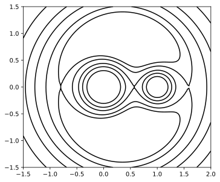

# Draw a Roche potential diagram

Draw the potential's level curves in the orbital plane, including branches beyond L2 and around L3.
Sample `potential_at()` on a grid and contour the values with Matplotlib:

```pycon
>>> import matplotlib.pyplot as plt
>>> import rocheometry
>>>
>>> binary = rocheometry.BinaryGeometry(q=2.0)
>>> xs = [-1.5 + 3.5 * i / 120 for i in range(121)]
>>> ys = [-1.5 + 3.0 * j / 120 for j in range(121)]
>>> grid = [[binary.potential_at((x, y, 0.0)).value for x in xs] for y in ys]
>>> critical = sorted(
...     point.potential.value for point in (binary.l1(), binary.l2(), binary.l3())
... )
>>> fig, ax = plt.subplots()
>>> _ = ax.contour(xs, ys, grid, levels=[*critical, 2.2, 2.6], colors="black")
>>> ax.set_aspect("equal")
>>> plt.close(fig)

```



These curves approximate the [contours](../guide/model.md#sections-silhouettes-and-contours) of the potential.
The grid must avoid the two point masses, where `potential_at()` raises `ValueError`.
A 121 × 121 grid takes about a third of a second.

For Bézier outlines of the components themselves, draw a [Roche lobe diagram](roche-lobe-diagram.md).
