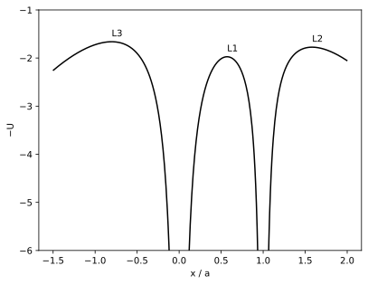

# Plot the potential along the line of centres

Plot the effective potential along the binary centreline and mark L1, L2 and L3.
Negate `potential_at()` to draw the physical effective potential, $-U$ in these units, with a well around each component:

```pycon
>>> import matplotlib.pyplot as plt
>>> import rocheometry
>>>
>>> binary = rocheometry.BinaryGeometry(q=2.0)
>>> xs = [-1.5 + 3.5 * (i + 0.5) / 400 for i in range(400)]
>>> depth = [-binary.potential_at((x, 0.0, 0.0)).value for x in xs]
>>> points = {"L1": binary.l1(), "L2": binary.l2(), "L3": binary.l3()}
>>>
>>> fig, ax = plt.subplots()
>>> _ = ax.plot(xs, depth, color="black")
>>>
>>> for name, point in points.items():
...     x, peak = point.position[0], -point.potential.value
...     _ = ax.annotate(name, (x, peak), xytext=(0, 6), textcoords="offset points")
>>> _ = ax.set(xlabel="x / a", ylabel="−U", ylim=(-6, -1))
>>>
>>> plt.close(fig)
>>> {name: round(-point.potential.value, 3) for name, point in points.items()}
{'L1': -1.973, 'L2': -1.774, 'L3': -1.661}

```



The peaks are the collinear Lagrange points, and L1 is the lowest, so it is the first to be reached as a component's surface rises out of its well.
The sample points are offset by half a step so that none lands on a point mass.
