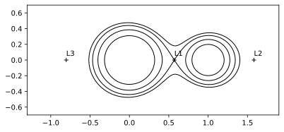

# Draw a Roche lobe diagram

Draw both Roche lobes, two detached levels and a contact envelope as vector outlines.
Use the same fill-out factor for both components at each level, and `section_envelope()` to leave out the contact envelope's watershed cut:

```pycon
>>> import matplotlib.pyplot as plt
>>> import rocheometry
>>> from rocheometry.matplotlib import path_patch
>>>
>>> binary = rocheometry.BinaryGeometry(q=2.0)
>>> paths = []
>>> for component in (binary.component(1), binary.component(2)):
...     paths.append(component.lobe().section())
...     for factor in (-3.0, -1.0):  # detached
...         paths.append(component.surface(fill_out_factor=factor).section())
...     paths.append(component.surface(fill_out_factor=0.5).section_envelope())
>>> fig, ax = plt.subplots()
>>> for path in paths:
...     _ = ax.add_patch(path_patch(path, linewidth=1))
>>> for name, point in {"L1": binary.l1(), "L2": binary.l2(), "L3": binary.l3()}.items():
...     x, y, _ = point.position
...     _ = ax.plot(x, y, "+", color="black")
...     _ = ax.annotate(name, (x, y), xytext=(0, 6), textcoords="offset points")
>>> _ = ax.set(xlim=(-1.3, 1.9), ylim=(-0.7, 0.7), aspect="equal")
>>> plt.close(fig)

```



The same paths make a standalone SVG, with one `<path>` per outline:

```pycon
>>> from rocheometry.svg import document_paths
>>> svg = document_paths(paths, y_axis="up")
>>> svg.count("<path")
8

```

The paths preserve their cubic Bézier segments when plotted or exported, so they stay sharp at any zoom.
They approximate the sections to the [outline accuracy bound](../guide/accuracy.md#public-bounds).
Selected levels must lie above L2, with fill-out factors below 1; see the model's [scope](../guide/model.md#scope).
To include level curves beyond L2, draw a [Roche potential diagram](potential-diagram.md).
