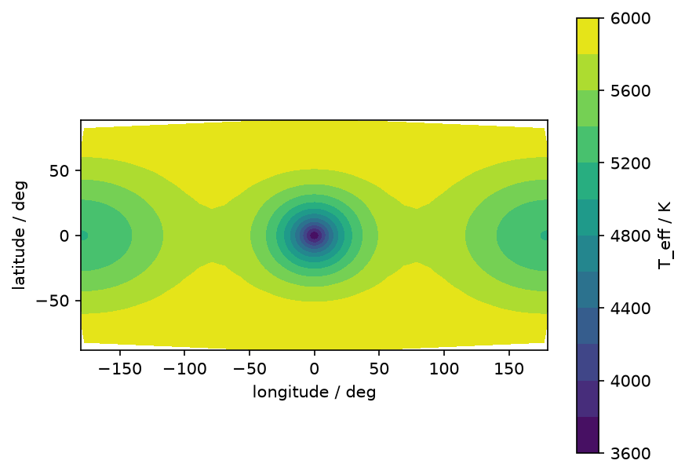

# Map surface temperature

Map gravity-darkened temperature in longitude and latitude using the quadrature nodes.
Use `T_eff ∝ g^0.25` and scale the hottest node to 6000 K:

```pycon
>>> from math import asin, atan2, degrees, sqrt
>>>
>>> import matplotlib.pyplot as plt
>>> import rocheometry
>>>
>>> surface = rocheometry.ComponentGeometry(0.5).surface(volume_radius_fill=0.99)
>>> nodes = surface.quadrature()
>>> longitude, latitude = [], []
>>> for x, y, z in nodes.positions:
...     longitude.append(degrees(atan2(y, x)))
...     latitude.append(degrees(asin(z / sqrt(x * x + y * y + z * z))))
>>>
>>> g_max = max(nodes.gravities)
>>> temperature = [6000 * (g / g_max) ** 0.25 for g in nodes.gravities]
>>> fig, ax = plt.subplots()
>>> filled = ax.tricontourf(longitude, latitude, temperature, levels=12)
>>> _ = fig.colorbar(filled, label="T_eff / K")
>>> _ = ax.set(xlabel="longitude / deg", ylabel="latitude / deg", aspect="equal")
>>> plt.close(fig)
>>> round(min(temperature))  # at the point facing L1
3671

```



Longitude 0 faces the companion along `+x`, and latitude is measured from the orbital plane.
The coolest region faces the companion, where gravity is weakest near L1; the hottest nodes lie near the poles.
The nodes do not reach the poles or the ±180° seam, so the map leaves thin margins there.
For a contact part, the nodes cover only its share of the envelope.
